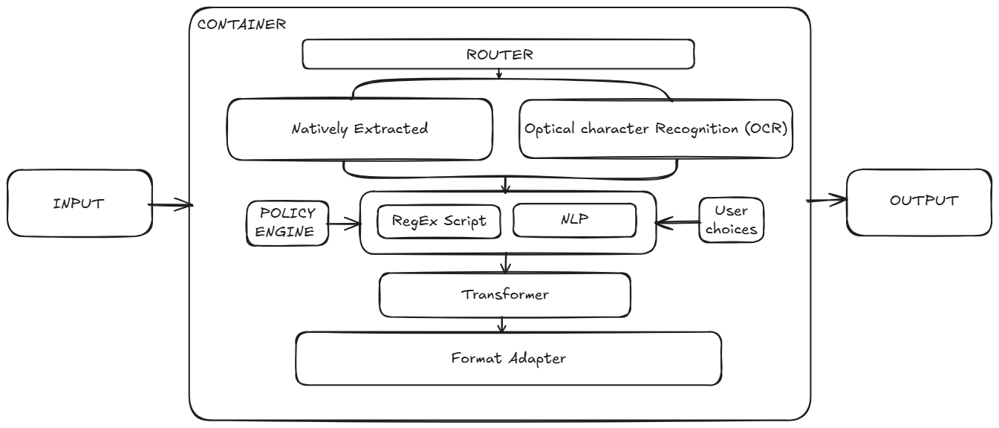

<div align="center">


# RE-DACT

### Privacy-Preserving, In-Memory Document Sanitization

An offline, gradational de-identification engine for plaintext, tabular datasets, images, and PDFs.<br>
Zero cloud dependencies · In-memory processing · Real-time level slider · Tamper-evident audit trail.

**[Overview](#overview)** &nbsp;·&nbsp;
**[Ecosystem](#the-ecosystem)** &nbsp;·&nbsp;
**[Legal Grounding](#legal-grounding--pii-taxonomy)** &nbsp;·&nbsp;
**[Architecture](#architecture--pipeline)** &nbsp;·&nbsp;
**[Redaction Levels](#redaction-levels-l1--l4)** &nbsp;·&nbsp;
**[Visual PII](#visual-pii-detection-photos--qr-codes)** &nbsp;·&nbsp;
**[Format Adapters](#format-adapters)** &nbsp;·&nbsp;
**[Web Application](#web-application--gui)** &nbsp;·&nbsp;
**[Quickstart](#quickstart)** &nbsp;·&nbsp;
**[Security & Privacy](#security--privacy)** &nbsp;·&nbsp;
**[Evaluation](#evaluation--benchmark)** &nbsp;·&nbsp;
**[The Mark](#the-mark)**

<p>
  <a href="#quickstart"></a>
  <a href="#security--privacy"></a>
  <a href="#security--privacy"></a>
  <a href="#legal-grounding--pii-taxonomy"></a>
  <a href="LICENSE"></a>
</p>
<p>
  
  
  
  
  <a href="#web-application--gui"></a>
  
</p>

</div>

> [!IMPORTANT]
> **Zero Data Retention & 100% Offline by Design**<br>
> RE-DACT processes sensitive documents strictly in memory (`RAM`/`tmpfs`). It executes zero outbound network calls, depends on zero third-party cloud APIs (no OpenAI, Gemini, or cloud OCR/NER), and stores **zero raw personal data** in logs, reports, or persistent storage.

> [!TIP]
> **Gradational Privacy (L1 to L4): Detect Once, Slide Freely**<br>
> Detection runs once and caches sensitive spans in a format-agnostic store. Moving the redaction slider instantly shifts transforms from light masking (L1) to quasi-identifier generalization (L2), HMAC-seeded consistent pseudonymization (L3), and synthetic generation (L4) without re-running expensive OCR or NLP models.

---

## Overview

Organizations across healthcare, law, finance, and government need to share documents and datasets without exposing personal or proprietary information. Existing de-identification solutions are typically:
* **All-or-nothing**: blunt redactions that destroy analytical and contextual utility.
* **Fragile & manual**: regex scripts that miss contextual, indirect, or visual identifiers.
* **Cloud-leaking**: sending private payloads to external LLMs and cloud APIs.

**RE-DACT** solves this with a **deterministic, modular pipeline** built on open local NLP, rule-based checksums, offline computer vision, and true format-native redaction adapters. It guarantees that the output matches the exact structure of the input, sanitizes text alongside non-text visual PII (face portraits and biometric QR codes), validates that no sensitive originals survive via an automated anti-leak verification scan, and provides cryptographic proof of sanitization through an HMAC-SHA256 signed audit report.

Built for **CONVERGE '26** (Blockchain & Cybersecurity Track) by team **StrangerStrings**.

---

## The Ecosystem

<table>
<tr>
<th width="33%">Ingestion & Detection</th>
<th width="33%">Policy & Transform</th>
<th width="33%">Adapters & Verification</th>
</tr>
<tr valign="top">
<td>

* **Content Gate**: Real MIME inspection, size caps, and decompression bomb guards
* **Dual-Path Routing**: Native-first extraction for digital text; PaddleOCR for scans/images
* **Regex + Checksum**: Verhoeff checksum for 12-digit Aadhaar; Luhn algorithm for cards; PAN, Passport, Voter ID, Driving License, Vehicle Reg, IFSC, Phone, Email
* **Zero-Shot NER**: Local GLiNER (`urchade/gliner_multi_pii-v1`) for names, orgs, and locations
* **Visual PII Detection**: Offline OpenCV Haar cascade for face portraits; QRCodeDetector for biometric QR codes
* **Context Engine**: Cue words ("Dr.", "Patient:", "A/c"), form labels, and mention propagation
* **Span Store**: Format-agnostic in-memory span index

</td>
<td>

* **Legal Grounding**: Entity taxonomy mapped to India's DPDP Act 2023 & IT Rules 2011
* **L1 (Light)**: Masking direct identifiers (`[PERSON]`, `XXXX XXXX 1234`, `[PHOTO]`, `[QR]`)
* **L2 (Medium)**: Generalizing quasi-identifiers (age ranges, minor flags, month/year dates, salary brackets)
* **L3 (Strong)**: Consistent pseudonymization (HMAC-seeded `Faker` stand-ins across session)
* **L4 (Synthetic)**: Realistic entity synthesis & perturbed values
* **Policy Presets**: Configurable entity-level checkboxes and legal compliance profiles
* **In-Memory Mappings**: Ephemeral real-to-fake translation discarded after session

</td>
<td>

* **Plaintext & Logs**: Exact offset replacement preserving encoding, BOM, and whitespace
* **Datasets (CSV/JSON/XLSX)**: Value modification with structure, headers, and formula preservation
* **Images**: True pixel clearing and flattening with EXIF metadata stripping
* **PDFs**: PyMuPDF true binary redaction (destroys underlying text/pixels; strips metadata, annotations, bookmarks)
* **Anti-Leak Re-scan**: Output re-extraction searching for residual originals
* **Cryptographic Report**: HMAC-SHA256 signed audit certificate
* **Web UI Server**: Lightweight built-in HTTP server with in-browser preview and safe save

</td>
</tr>
</table>

---

## Legal Grounding & PII Taxonomy

RE-DACT's policy engine (`policy/policy.py`) is grounded in Indian statutory frameworks:
1. **Digital Personal Data Protection (DPDP) Act, 2023** (§2(t) Personal Data, §2(c) & §9 Protection of Children/Minors, §15(c) Unique Government Identifiers).
2. **Information Technology (SPDI) Rules, 2011** (Rule 3 — Sensitive Personal Data or Information).
3. **The Aadhaar Act, 2016** (Verhoeff checksum validation).

| Level | Legal Tier | Entity Types Covered | Redaction Action |
| :---: | :--- | :--- | :--- |
| **L1** | **Direct Identifiers & Biometrics**<br>*(DPDP §15(c) & IT Rules Rule 3)* | `AADHAAR` (Verhoeff verified), `PAN`, `PASSPORT`, `VOTER_ID`, `DRIVING_LICENSE`, `VEHICLE_REG`, `BANK_ACCOUNT`, `CARD_NUMBER` (Luhn), `IFSC`, `UPI_ID`, `PHONE`, `EMAIL`, `PERSON`, `[PHOTO]` (Face), `[QR]` (Biometric QR) | **Masking**: Generic tokens (`[PERSON]`, `[PHOTO]`) or partial character masks (`XXXX XXXX 1234`). |
| **L2** | **Quasi-Identifiers & SPDI**<br>*(IT Rules Rule 3 health/demographics & DPDP §2(c))* | `DATE_OF_BIRTH`, `AGE`, `AGE_MINOR` (flagged highest-risk), `GENDER`, `BLOOD_GROUP`, `RELIGION`, `CASTE`, `DISABILITY`, `HEALTH_INFO`, `JOB_TITLE`, `SALARY` | **Generalization**: Reducing precision (e.g., age 34 $\rightarrow$ "30s", date $\rightarrow$ month/year, salary $\rightarrow$ bracket). |
| **L3** | **Context & Geographic Identifiers** | `ADDRESS`, `CITY`, `STATE`, `PINCODE`, `ORGANIZATION`, `SOCIAL_PROFILE`, `IP_ADDRESS` | **Pseudonymization**: Consistent realistic fakes per session via HMAC-seeded `Faker` (same original entity $\rightarrow$ identical fake). |
| **L4** | **Complete Synthesis** | All detected sensitive entities | **Full Synthesis**: Complete entity substitution with perturbed numeric values; cross-record statistical linkage broken. |

---

## Architecture & Pipeline

RE-DACT processes files in a single unified flow where detection is performed once and all subsequent actions are governed by the selected policy level:

<div align="center">
  
</div>

---

## Visual PII Detection (Photos & QR Codes)

Official documents, certificates, and ID cards (Aadhaar, PAN, Voter IDs) contain critical non-text visual PII that OCR cannot read as text. RE-DACT includes dedicated **visual PII detection**:

* **Personal Portraits & Face Photos (`[PHOTO]`)**: Detected using offline OpenCV Haar Feature-based Cascades (`haarcascade_frontalface_default.xml`).
* **Biometric QR Codes & Barcodes (`[QR]`)**: Detected using OpenCV's native `QRCodeDetector()`, locating QR regions holding encoded personal demographic or biometric payload.
* **100% Offline & Lightweight**: Requires zero external network calls and zero additional heavy dependencies, utilizing standard OpenCV.
* **Permanent Destruction**: Bounding boxes are mapped to `NormalizedDoc` and irreversibly blacked out, blurred, or pixelated in the output image/PDF stream.

---

## Redaction Levels (L1 – L4)

The slider controls the depth of de-identification. Changing the level updates the transform applied to detected spans without needing to re-parse the document:

| Level | Name | Target Entities | Transform Applied | Visual Example |
| :---: | :--- | :--- | :--- | :--- |
| **L1** | **Light** | Direct Identifiers (Names, Aadhaar, PAN, Phone, Email, Bank A/C, Photo, QR) | **Masking**: Replaced with generic tokens or partial character masks. | `Priya Sharma` $\rightarrow$ `[PERSON]`<br>`98765 43210` $\rightarrow$ `XXXXX 43210`<br>Face portrait $\rightarrow$ Blackout box |
| **L2** | **Medium** | L1 + Quasi-Identifiers (Ages, Exact Dates, Specific Job Titles, Health) | **Generalization**: Reduces precision to prevent linkage attacks. | `Age 34` $\rightarrow$ `30s`<br>`14/08/1992` $\rightarrow$ `Aug 1992`<br>`Lead Neurosurgeon` $\rightarrow$ `Doctor` |
| **L3** | **Strong** | L2 + Geographic & Demographic Context (Cities, Orgs, Full Addresses) | **Pseudonymization**: Consistent realistic fakes per session via HMAC-seeded `Faker`. | `Dr. Priya Sharma at AIIMS Delhi` $\rightarrow$ `Dr. Ananya Iyer at Apollo Hospital` *(consistent throughout)* |
| **L4** | **Synthetic** | Complete Entity Replacement | **Full Synthesis**: Complete entity substitution with perturbed numeric values. | Fully synthetic, realistic profile with broken cross-record statistical linkage. |

---

## Format Adapters

Redaction occurs directly inside the original format layer to preserve layout, styling, and structural metadata:

* **Plaintext & Logs (`.txt`, `.log`, `.json`)**: Operates on character offsets; preserves original encoding, BOM, whitespace, and line endings.
* **Tabular Data (`.csv`, `.tsv`, `.xlsx`)**: Modifies data cell values while retaining formulas, column headers, cell dimensions, and sheet structures. Supports cross-row pseudonym consistency.
* **Images (`.png`, `.jpg`, `.jpeg`, `.heic`, `.webp`, `.bmp`)**: PaddleOCR maps word-level bounding boxes alongside OpenCV visual PII boxes. Redacted regions are filled and permanently flattened (destroying underlying pixels). All EXIF and GPS tags are stripped.
* **PDFs (`.pdf`)**: Native-first text coordinate extraction with PyMuPDF, falling back to PaddleOCR for scanned pages. Uses **PyMuPDF true redaction annotations** to eradicate text and pixel matrices from the binary stream. Strips PDF metadata, annotations, bookmarks, and revision history.

---

## Web Application & GUI

RE-DACT ships with a zero-dependency, high-performance web application powered by a built-in Python HTTP server (`server.py`) and a modern web dashboard (`ui/index.html`):

* **Interactive Local Dashboard**: Runs locally at `http://127.0.0.1:8000/`.
* **Drag-and-Drop Ingestion**: Multi-file queue supporting simultaneous text, image, and PDF uploads.
* **Live In-Browser Preview**: Inspect before-and-after redaction results directly in the browser with live visual comparison.
* **Real-Time Level Slider**: Smoothly adjust redaction levels (**Mask $\leftrightarrow$ Generalise $\leftrightarrow$ Pseudonyms $\leftrightarrow$ Synthetic**) with instant feedback.
* **Safe Non-Overwriting Save**: One-click download that writes directly to `~/Desktop/REDACT_Outputs` without overwriting existing files (`file_redacted.ext`, `file_redacted_1.ext`).
* **Zero UI Flicker**: Threaded background job processing with progressive status reporting.
* **Local REST API**:
  - `GET /api/health` — System status and capability check.
  - `POST /api/jobs` — Upload files and start an asynchronous redaction job.
  - `GET /api/jobs/:id` — Retrieve job progress, file completion status, and preview snippets.
  - `GET /api/jobs/:id/file/:idx` — Stream the redacted file for in-browser visual inspection.
  - `POST /api/jobs/:id/save` — Export redacted outputs to the desktop output folder.
  - `POST /api/jobs/:id/open` — Open the output folder in the native file manager (`xdg-open` / Finder / Explorer).

---

## Verification & Anti-Leak Assurance

A document that appears sanitized on-screen can still leak sensitive strings through OCR discrepancies, hidden layers, or encoding quirks. RE-DACT includes an automated verification step:

1. **Re-Extraction**: The generated output is re-extracted using the recipient's view (native PDF parser for digital PDFs; OCR for flattened images).
2. **Residual Matching**: The extracted stream is matched against the list of original sensitive strings using exact and fuzzy matching.
3. **Adaptive Retry**: If a residual leak is detected, the pipeline automatically falls back to a stricter labeled mask (`[REDACTED]`).
4. **Cryptographic Attestation**: The engine generates a SHA-256 fingerprint of input and output documents, along with an HMAC-SHA256 signature calculated with `REDACT_HMAC_KEY`.

```json
{
  "timestamp": "2026-11-17T11:25:00Z",
  "input_hash": "e3b0c44298fc1c149afbf4c8996fb92427ae41e4649b934ca495991b7852b855",
  "output_hash": "a591a6d40bf420404a011733cfb7b190d62c65bf0bcda32b57b277d9ad9f146e",
  "level": 3,
  "spans_detected": 14,
  "spans_redacted": 14,
  "residual_risk": 0,
  "verified_clean": true,
  "hmac_signature": "7d5a9...4b8c"
}
```

> [!NOTE]
> Audit logs store **metadata only** (entity categories, counts, and hashes). Original PII values are never written to logs or error messages.

---

## Quickstart

### Prerequisites
* **OS**: Linux (Arch/CachyOS, Ubuntu, Debian), macOS, or Windows
* **Python**: **3.12** *(Python 3.14 breaks ML wheels)*
* **Environment Manager**: [uv](https://github.com/astral-sh/uv) (recommended) or standard virtualenv

### 1. Installation

```fish
# Clone the repository
git clone https://github.com/OrbisEarendel/RE-DACT.git redact && cd redact

# Create virtual environment with Python 3.12
uv venv --python 3.12
source .venv/bin/activate.fish   # Bash/Zsh: source .venv/bin/activate | Windows: .venv\Scripts\activate

# Install PyTorch CPU build
uv pip install torch --index-url https://download.pytorch.org/whl/cpu

# Install dependencies
uv pip install -r requirements.txt

# Configure environment
cp .env.example .env

# Download models locally (one-time setup, requires internet)
python scripts/download_models.py
```

### 2. Configuration (`.env`)

Generate a deployment signing key:
```bash
python -c "import secrets; print(secrets.token_hex(32))"
```

Edit your `.env` file:
```env
# Cryptographic signing key for verification reports
REDACT_HMAC_KEY=your_generated_64_character_hex_key_here

# Runtime limits
REDACT_MAX_FILE_MB=25
REDACT_ALLOWED_EXT=txt,log,csv,json,xlsx,png,jpg,jpeg,heic,pdf

# Hardened offline mode (1 = refuse any outbound network call)
REDACT_OFFLINE=1
REDACT_LOG_LEVEL=INFO
```

### 3. Launch the Application

#### Official Web Dashboard (Fast Built-in Server)
```bash
python server.py 8000
```
Open **`http://127.0.0.1:8000/`** in your browser to access the full interactive interface with drag-and-drop processing, real-time level sliders, and live in-browser output previews.

#### CLI Command Line
```bash
# Redact a sample file at Level 1 (Light Masking)
python -m app.cli samples/test.txt --level 1

# Redact an image with PaddleOCR at Level 3 (Pseudonymization)
python -m app.cli samples/id_card.png --level 3
```

### 4. Run Test Suite
```bash
pytest -q
```
Runs the full suite of unit and integration tests across checksums, regex identifiers, GLiNER NER, visual PII classifiers, context rules, policy filtering, format writers, and transform levels.

---

## Security & Privacy

RE-DACT is engineered from the ground up to handle sensitive datasets without creating secondary leakage vectors:

* **In-Memory Lifespan**: Files and intermediate representations live strictly in volatile memory. No temporary files holding original data are saved to disk.
* **Ephemeral Pseudonym Keys**: The HMAC seed used to generate deterministic fake identities is held in RAM only and zeroed immediately upon session termination. Cross-document entity linking is impossible.
* **Isolated Containerization**: Production deployment utilizes a minimal container with a read-only root filesystem, dropped capabilities, no root user, and `--network none` network isolation.
* **Safe Parser Sandbox**: File parsing executes in unprivileged worker processes with strict resource quotas to mitigate decompression bombs and malformed file exploits.
* **No Telemetry / No Call-Homes**: Guaranteed offline operation. Setting `REDACT_OFFLINE=1` forces immediate termination on any outbound socket request.

---

## Evaluation & Benchmark

RE-DACT is evaluated against **Microsoft Presidio** using entity-level **Precision, Recall, and F1** metrics across open benchmark datasets:

* **Indian Identification Benchmarks**: High-precision evaluation on national IDs (Aadhaar with Verhoeff validation, PAN, IFSC codes, Indian mobile number formats).
* **Open Healthcare & De-id Sets**: Evaluated on public benchmark de-identification collections (MIMIC-III de-id subsets, synthetic patient records).
* **Ablation Studies**: Quantifying the contribution of deterministic rules vs. zero-shot GLiNER vs. context heuristics vs. visual PII detection.
* **Utility vs. Privacy Curve**: Measuring downstream utility retention across levels L1 through L4.

Run the evaluation harness:
```bash
python eval/run_eval.py --dataset eval/datasets/dummy_test_set.json
```

---

## The Mark

<picture>
  
</picture>

The **RE-DACT** logo represents the balance between privacy protection and structural integrity: a cryptographic lock intertwined with clean document lines and a precision shielding aperture. The deep blue and cyan accents signify trust, offline containerization, and verifiable data security.

<br clear="left">

---

## Team

Developed with pride for **CONVERGE '26** by **StrangerStrings**:
* **Track**: Blockchain & Cybersecurity (Software)
* **Goal**: Deliver a verifiable, containerized proof of concept that proves de-identification can be fast, offline, and gradational.

---

## License

This project is licensed under the **MIT License** — see the [LICENSE](LICENSE) file for details. Built using [PaddleOCR](https://github.com/PaddlePaddle/PaddleOCR), [GLiNER](https://github.com/urchade/GLiNER), [OpenCV](https://opencv.org/), [PyMuPDF](https://github.com/pymupdf/PyMuPDF), and Python stdlib.
